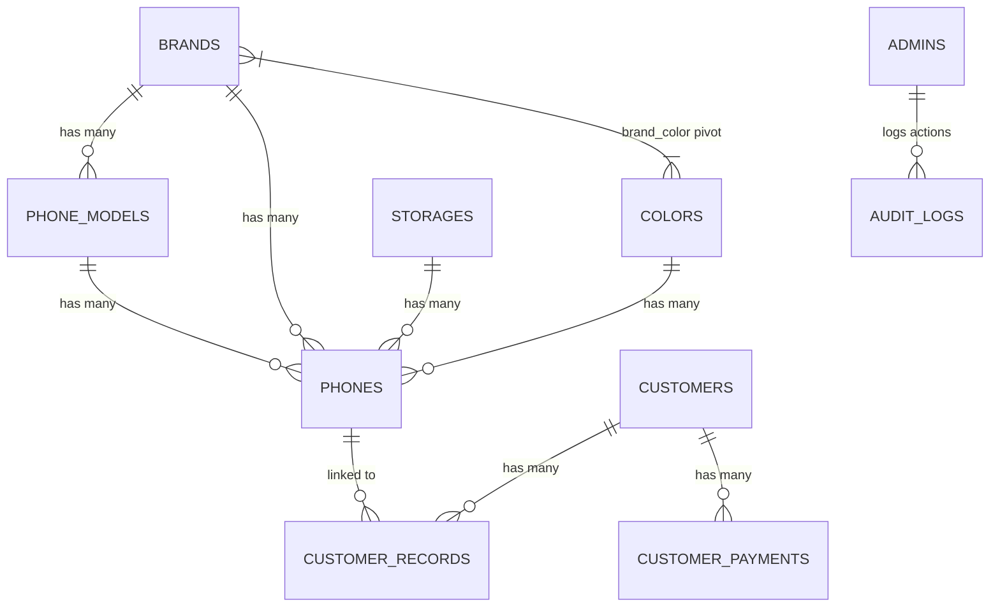
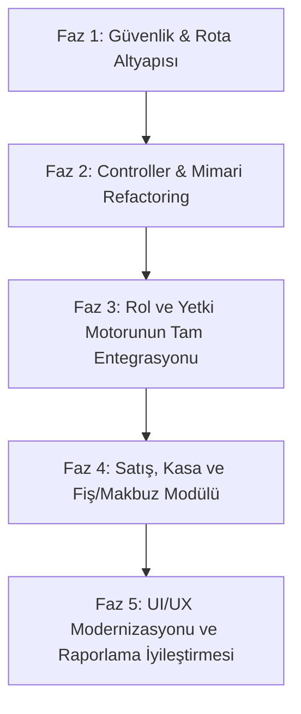

# Macrotech Telefon Stok, Satış ve Müşteri Takip Sistemi - Sistem Analiz Raporu

**Tarih:** 27 Ekim 2026  
**Durum:** Mevcut Sistem Analizi ve Güncelleme Öncesi Mimari İnceleme  
**Proje Konumu:** `c:\xampp\htdocs\stokTakip`

---

## 1. Genel Bakış ve Proje Amacı

Macrotech Stok Takip Sistemi; cep telefonu alım-satımı, stok yönetimi, müşteri cari/veresiye borç takibi, kasa tahsilatları ve mağaza vitrini sunan **Laravel 12** tabanlı kapsamlı bir işletme otomasyonudur.

Sistem iki temel arayüzden oluşmaktadır:
1. **Müşteri Vitrini (Public Web):** Müşterilerin stoktaki ve öne çıkan telefonları inceleyebildiği, cihaz detaylarını gördüğü ve WhatsApp üzerinden anında mağaza ile iletişime geçebildiği kullanıcı dostu katalog sitesi.
2. **Yönetim Paneli (Admin Portal):** Stok girişleri, çoklu seri no / IMEI kaydı, parça parça/peşin satış işlemleri, geri alım (repurchase), müşteri borç/alacak yönetimi, işlem logları (audit log) ve finansal raporlamanın yürütüldüğü idari panel.

---

## 2. Teknoloji Yığını ve Altyapı

| Bileşen | Teknoloji / Sürüm | Açıklama |
| :--- | :--- | :--- |
| **Framework** | Laravel 12.x | Modern PHP çatısı |
| **PHP Sürümü** | PHP ^8.2 | Modern dil özellikleri, katı tipleme |
| **Veritabanı** | MySQL (XAMPP) | Veritabanı adı: `telefon` (InnoDB ilişkisel model) |
| **Ön Yüz (Frontend)** | Blade Templates, Tailwind CSS (CDN 2.2.19), FontAwesome 6 | Responsive, hızlı yüklenen arayüz |
| **Bildirimler & UI** | SweetAlert2, Vanilla JS | İnteraktif onaylar ve dinamik filtreleme |
| **Web Sunucusu** | Apache (XAMPP) / Artisan Serve | Yerel geliştirme ortamı |
| **Dosya Depolama** | Laravel Storage (`storage/app/public`) & Public Assets | Cihaz görselleri, logolar ve faviconlar |

---

## 3. Sistem Mimarisi ve Modül Analizi

### 3.1. Vitrin & Müşteri Arayüzü (Public Frontend)
- **Ana Sayfa (`/` - `home.blade.php`):** Öne çıkan telefonlar (`is_featured = true`), vitrin bannerları ve hızlı iletişim alanları.
- **Katalog (`/telefonlar` - `phones/index.blade.php`):** Satışta olan (`is_sold = false`) telefonların sayfalamalı (pagination) listesi.
- **Ürün Detay (`/telefon/{phone}` - `phones/show.blade.php`):** Cihazın kondisyonu (Sıfır / 2. El), menşei (TR / Yurt Dışı), teknik özellikleri, resim galerisi, benzer ürün önerileri ve doğrudan WhatsApp satın alma butonu.
- **İletişim & Kurumsal Sayfalar (`/iletisim`, `/gizlilik-politikasi`, `/kullanim-sartlari`, `/cerez-politikasi`):** Dinamik mağaza iletişim bilgileri, Google Maps harita entegrasyonu ve yasal sözleşmeler.

### 3.2. Kimlik Doğrulama & Yetkilendirme (Auth & RBAC)
- **Giriş / Çıkış (`/login`, `/giris`, `/logout`):** `Admin` modeli üzerinden e-posta ve `Hash::check()` ile şifre doğrulaması.
- **Oturum Yönetimi:** `session(['admin_logged_in' => true, 'admin_id' => ..., 'admin_role' => ...])` üzerinden özel oturum kontrolü.
- **Rol Hiyerarşisi (4 Rol):**
  1. `super_admin`: Sistemdeki tüm yetkilere sahiptir. Diğer adminleri silebilir, ayarları değiştirebilir.
  2. `admin`: Genel yönetim ve audit logları izleme yetkisine sahiptir, admin silemez.
  3. `manager`: Telefon, müşteri, satış işlemlerini yürütür; admin yönetimi ve audit log göremez.
  4. `staff`: Yalnızca temel satış ve telefon listeleme işlemlerine erişir.
- **Özel İzinler (Permissions JSON):** `phones.create`, `phones.update`, `phones.delete`, `sales.create`, `customers.create`, `payments.process`, `reports.view`.

### 3.3. Stok & Cihaz Yönetimi (`/admin/phones`)
- **Cihaz Özellikleri:** Marka, Model, Renk, Depolama (Hafıza), Alış Fiyatı, Satış Fiyatı, Durum (`sifir`, `ikinci_el`), Menşei (`turkiye`, `yurtdisi`), Açıklama, Notlar, Müşteri Bilgisi.
- **Toplu Seri No / IMEI Girişi:** Tek işlemde birden fazla seri numarası eklenerek seri no adedi kadar bağımsız cihaz kaydı oluşturulabilir.
- **Çoklu Görsel Yönetimi:** JSON formatında resim dizisi (`images`).
- **Geri Alım (Repurchase):** Satılmış bir cihazın geri alınarak (`is_sold = false`, `repurchase_price`, `repurchased_at`) tekrar stoka dahil edilmesi.

### 3.4. Satış ve Ödeme Döngüsü (`/admin/sales`, `/admin/phones/sell`)
- **Hızlı Satış:** Seri numarası ile arama yapılarak anında satış modalı üzerinden işlem.
- **Ödeme Seçenekleri:**
  - **Peşin (Full):** Tüm tutar tahsil edilir, müşteri kaydı tam ödenmiş (`paid`) olarak açılır veya kapatılır.
  - **Parçalı / Kısmi (Partial):** Peşinat alınır, kalan tutar `remaining_debt` olarak müşterinin hanesine borç yazılır (`partial` veya `pending`).
- **Veritabanı Bütünlüğü:** Satış işlemleri `DB::beginTransaction()` ile sarmalanarak tutarsızlıkların önüne geçilmiştir.
- **Satış İptali (`deleteSale`):** Satış kaydının silinmesi, cihazın tekrar stoka iadesi ve müşteri borç bakiyesinin geri düzeltilmesi.

### 3.5. Müşteri & Veresiye / Borç Takip Modülü (`/admin/customers`)
- **Müşteri Profili:** Ad, Soyad, Telefon, Borç toplamı, Notlar.
- **Gelişmiş Arama:** Ad-soyad ayrıştırmalı (akıllı split arama) ve telefon bazlı filtreleme.
- **Borç Filtresi:** `has_debt` (Borçlu olanlar) ve `no_debt` (Borcu olmayanlar) listeleri.
- **Cari Kayıtlar (`CustomerRecord`):** Hangi tarihte hangi telefonun kaça satıldığı, ne kadar ödendiği ve ne kadar kaldığı.
- **Ödeme Alma / Tahsilat (`CustomerPayment`):** Nakit, IBAN veya Kredi Kartı ile parça parça ödeme alabilme, tahsilatın borç kayıtlarına düşürülmesi.

### 3.6. Parametrik Veri Yönetimi (`/admin/data`)
- **Markalar (`Brand`):** Apple, Samsung, Xiaomi vb.
- **Modeller (`PhoneModel`):** Markaya bağlı modeller (iPhone 15 Pro, Galaxy S24 vb.). Marka seçildiğinde AJAX ile ilgili modeller yüklenir.
- **Renkler (`Color`):** Renk tanımları ve `brand_color` pivot tablosu ile markaya özgü renk eşleşmeleri.
- **Depolama Seçenekleri (`Storage`):** 64 GB, 128 GB, 256 GB, 512 GB, 1 TB vb.

### 3.7. Finansal Raporlama ve Kasa (`/admin/reports`)
- Tarih aralığına göre (Bugün, Bu Hafta, Bu Ay, Bu Yıl, Özel Aralık) filtreleme.
- Toplam Satış Adedi, Toplam Ciro, Tahmini Brüt Kâr (Satış Fiyatı - Alış Fiyatı farkı).
- Güncel Stok Adedi ve Stoktaki Cihazların Toplam Alış Maliyeti.
- En çok satan markalar ve modeller analizi.

### 3.8. İşlem Geçmişi (Audit Logs) ve Sistem Ayarları
- **Audit Logs (`/admin/audit-logs`):** Kullanıcı oturum açmaları, telefon ekleme/güncelleme/silme, satış, geri alım ve ödeme işlemlerinin IP, User Agent ve JSON bazında eski/yeni değer farklarıyla loglanması.
- **Mağaza Ayarları (`/admin/settings`):** Firma unvanı, iletişim numaraları, WhatsApp destek hattı, çalışma saatleri, Google Maps iframe kodu, site logosu ve favicon dosya yükleme yönetimi.

---

## 4. Veritabanı Şeması ve Tablo İlişkileri

### Tablo Detayları:
1. **`phones`:** `id`, `name`, `brand_id`, `phone_model_id`, `color_id`, `storage_id`, `purchase_price`, `sale_price`, `stock_serial`, `condition`, `origin`, `notes`, `customer_info`, `images` (JSON), `is_featured`, `is_sold`, `sold_at`, `repurchased_at`, `repurchase_price`.
2. **`customers`:** `id`, `name`, `surname`, `phone`, `debt`, `notes`.
3. **`customer_records`:** `id`, `customer_id`, `phone_id`, `sale_price`, `purchase_price_at_sale`, `paid_amount`, `remaining_debt`, `payment_status`, `notes`.
4. **`customer_payments`:** `id`, `customer_id`, `amount`, `previous_debt`, `remaining_debt`, `payment_method`, `notes`.
5. **`admins`:** `id`, `name`, `email`, `password`, `role`, `permissions` (JSON), `is_active`, `last_login_at`, `last_login_ip`.
6. **`audit_logs`:** `id`, `admin_id`, `action`, `model_type`, `model_id`, `description`, `old_values` (JSON), `new_values` (JSON), `ip_address`, `user_agent`.
7. **`settings`:** `id`, `key`, `value`, `type`, `group`, `description`.
8. **`brands`, `phone_models`, `colors`, `storages`, `brand_color`:** İlişkisel tanımlama tabloları.

---

## 5. Mevcut Sistemin Zayıf Noktaları ve Teknik Borç Analizi

Sistem işlevsel olarak çalışmakta olup, bir sonraki güncellemede ele alınması gereken kritik başlıklar şunlardır:

### 5.1. Güvenlik ve Middleware Açığı
- **Sorun:** Rotalar `routes/web.php` içinde herhangi bir route middleware grubu (`Route::middleware(...)`) içine alınmamıştır.
- **Risk:** Güvenlik kontrolü controller metotlarında tek tek `if (!session('admin_logged_in'))` şeklinde yapılmıştır. Yeni bir fonksiyon veya rota eklendiğinde bu satır unutulursa rota korumasız kalır.
- **Çözüm:** Özel bir `AdminAuthenticate` middleware'i yazılmalı, rotalar `Route::prefix('admin')->middleware(['admin.auth'])` çatısı altında toplanmalıdır.

### 5.2. Controller Şişkinliği (Monolitik AdminController)
- **Sorun:** `AdminController.php` dosyası **1,944 satır** uzunluğundadır. Kimlik doğrulama, telefon işlemleri, satış, iade, veri yönetimi, ayarlar, raporlar, admin CRUD ve audit logların tamamı tek bir sınıftadır.
- **Risk:** Bakım zorluğu, merge çakışmaları, test edilebilirlik düşüklüğü ve kod karmaşası.
- **Çözüm:** Tek Sorumluluk İlkesi (Single Responsibility Principle) uyarınca controller'lar modüler hale getirilmelidir:
  - `AuthController`: Giriş/çıkış işlemleri
  - `DashboardController`: İstatistikler ve ana panel
  - `PhoneController (Admin)`: Cihaz ve stok yönetimi
  - `SaleController`: Satış, iade ve seri no işlemleri
  - `DataManagementController`: Marka, model, renk, depolama yönetimi
  - `SettingController`: Mağaza ayarları ve logo yükleme
  - `ReportController`: Finansal ve stok raporları
  - `AdminUserController`: Yönetici hesapları ve yetkiler
  - `AuditLogController`: Log izleme

### 5.3. Rol ve Yetki (RBAC) Kontrollerinin Eksikliği
- **Sorun:** `ROL_YETKILERI.md` dosyasında 4 rol ve detaylı yetkiler tanımlanmış olmasına rağmen, `AdminController` içindeki kritik fonksiyonlarda (telefon ekle/sil, satış yap, müşteri sil vb.) `$admin->hasPermission()` veya rol kontrolleri kod seviyesinde uygulanmamıştır. Personel (staff) rolündeki biri doğrudan URL'yi bildiğinde her şeyi yapabilir durumdadır.
- **Çözüm:** Blade şablonlarında `@canAdmin` / rol direktifleri ve controller/middleware seviyesinde yetki kapıları (Gate / Policy veya Role Middleware) devreye alınmalıdır.

### 5.4. Veri Bütünlüğü ve Kasa Mantığı
- **Sorun:** Günlük kasa hareketleri (giren nakit, çıkan masraflar, iadeler) sadece telefon satışları ve tahsilatlar üzerinden dolaylı izlenmektedir. Genel mağaza giderleri (kira, fatura, personel avansı vb.) veya harici gelirler için bir Kasa/Gider modülü bulunmamaktadır.
- **Çözüm:** Güncelleme planına basit bir Kasa ve Gelir/Gider modülü dahil edilmelidir.

### 5.5. Fatura ve Satış Bilgi Fişi (Makbuz) Çıktısı
- **Sorun:** Satış sonrasında veya borç ödemesi yapıldığında müşteriye verilebilecek termal fiş veya PDF formatında bilgi makbuzu / garanti formu yazdırma özelliği bulunmamaktadır.
- **Çözüm:** Satış ve tahsilat detayında "Yazdır / Fiş Oluştur" (Printable Receipt / Invoice) şablonu eklenmelidir.

---

## 6. Planlanan Sistem Güncelleme Yol Haritası (Upgrade Roadmap)

Sistem güncellemesi için önerilen aşamalı plan:

### **Faz 1: Güvenlik, Rota Gruplaması & Middleware**
- [x] Özel `AdminAuthenticate` middleware'i oluşturuldu ve `bootstrap/app.php` içinde alias olarak tanımlandı.
- [x] Özel `CheckAdminPermission` yetki middleware'i oluşturuldu.
- [x] `routes/web.php` dosyasındaki tüm korumalı admin rotaları `Route::middleware(['admin.auth'])` çatısı altında toplandı.
- [x] Oturum güvenliği, email senkronizasyonu ve yetkisiz yönlendirme (302 -> /giris) doğrulandı.

### **Faz 2: Mimari Refactoring (Controller Ayrıştırma)**
- [ ] 1,944 satırlık `AdminController.php` dosyasının modüler controller'lara bölünmesi:
  - `Admin\AuthController`
  - `Admin\DashboardController`
  - `Admin\PhoneStockController`
  - `Admin\SaleController`
  - `Admin\MasterDataController`
  - `Admin\SettingsController`
  - `Admin\ReportsController`
  - `Admin\AdminManagementController`
  - `Admin\AuditLogController`
- [ ] Ortak iş mantıkları için Service sınıflarının (Örn: `SaleService`, `PaymentService`) hazırlanması.

### **Faz 3: Rol ve Yetkilendirme (RBAC) Entegrasyonu**
- [x] `Admin` modelindeki `hasPermission` motoru ve roller (`super_admin`, `admin`, `manager`, `staff`) tam hiyerarşiyle yapılandırıldı.
- [x] Personel için `phones.view`, `customers.view`, `sales.view` örtük izinleri sağlandı.
- [x] Tüm rotalar `admin.perm:...` rota seviyesinde ve controller katmanında çift yönlü korumaya alındı.
- [x] Sidebar menüleri oturum açan kullanıcının yetkilerine göre dinamik filtrelendi.
- [x] Yetkisiz erişimlerde standart SweetAlert2 / HTTP 403 hata yönlendirmesi devreye alındı.

### **Faz 4: Kasa, Tahsilat & Bilgi Fişi (Termal Makbuz) Çıktısı**
- [ ] Satış ve tahsilat işlemleri için yazdırmaya hazır (Print-friendly / 80mm POS termal fiş veya A5) Bilgi Makbuzu oluşturulması.
- [ ] Basit Kasa Giriş/Çıkış (Gelir-Gider) tablosu ve günlük net kasa takibi.
- [ ] Müşteri borç ekstresi (PDF/Yazdırılabilir hesap dökümü).

### **Faz 5: Arayüz (UI/UX) ve Raporlama Zenginleştirmesi**
- [ ] Admin panelinde modernleştirilmiş kartlar, daha akıcı geçişler ve modal pencereleri.
- [ ] Gelişmiş Excel / CSV dışa aktarma (Stok listesi, satışlar, müşteri borçları).
- [ ] Cihaz filtreleme ve anlık stok arama hızlandırmaları.

---

## 7. Sonuç ve Özet Değerlendirme

Mevcut Macrotech Stok Takip sistemi, temel işletme ihtiyaçlarını başarıyla karşılayan, güçlü bir ilişkisel veritabanı şemasına ve detaylı bir audit log altyapısına sahiptir. 

Yapılacak sistem güncellemesi ile güvenlik açıklarının kapatılması (middleware), mimari borçların temizlenmesi (controller refactoring), rol kontrollerinin kesinleştirilmesi ve fiş/makbuz gibi saha ihtiyaçlarının eklenmesiyle sistem tam kurumsal ve sürdürülebilir bir seviyeye kavuşacaktır.
